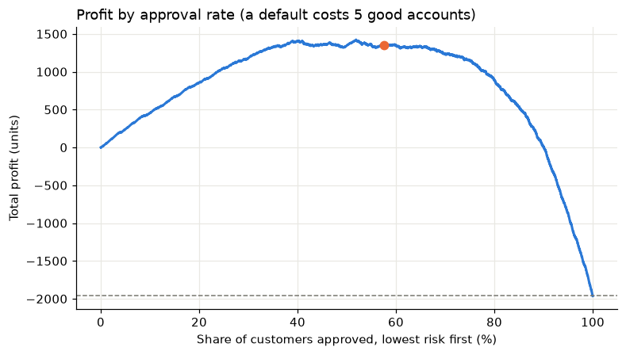

# Credit default risk scoring

A probability of default model, credit score and profit-based approval cutoff built from six months of repayment behaviour, with a fairness audit.

**[Open the live dashboard](https://chiamaka-uchenna.github.io/credit-default-risk/)** · **[Read the notebook](notebooks/credit_default_risk.ipynb)**



## The problem

Every lender trades off two errors: approving customers who default, and declining customers who would have repaid. A good risk model reduces both, but it also has to be explainable and fair, because lending decisions are regulated.

## Data

[Default of Credit Card Clients](https://archive.ics.uci.edu/dataset/350/default+of+credit+card+clients) (UCI Machine Learning Repository, CC BY 4.0). 30,000 real credit card customers of a bank in Taiwan, 2005 (Yeh and Lien, 2009).

The notebook downloads the data itself the first time it runs and caches it in `data/raw/`, so nothing needs to be downloaded by hand.

## Key results

- 29,965 customers after cleaning, 22.1% of whom defaulted the following month.
- Chosen model (gradient boosting with monotonic constraints): AUROC 0.787, Gini 0.574, KS 0.426. Logistic regression: AUROC 0.753.
- The model uses no demographics. Adding sex, age, education and marital status would raise AUROC by only 0.003, so leaving them out is nearly free.
- With a default costing five good accounts, approving everyone loses 1,963 units on the test set. Approving customers below the break-even risk of 16.7% approves 58% of customers, with a 10.1% default rate, and earns 1,355 units. That is 95% of the best cutoff found in hindsight.
- Every sex, age and education group passes the four-fifths approval screen (lowest ratio 0.90). Calibration is slightly off for men and for customers in their forties, which is reported in the notebook.

## Approach

1. Data quality checks and handling of undocumented category codes
2. Behavioural features: delinquency severity and persistence, utilisation, payment ratios, balance trend
3. Monotonic constraints so that more late payments can never lower predicted risk
4. AUROC, Gini, KS, Brier score and calibration
5. Score scaling (600 points at 10 to 1 odds, 50 points to double the odds), profit curve, SHAP, fairness audit

Every step is explained in the notebook, with the reasoning behind each decision.

## Live dashboard

The dashboard is a static page served by GitHub Pages from the `docs/` folder. The trained model is exported from the notebook as JSON and scored in the browser with a few lines of JavaScript, so there is no server to maintain. The notebook checks that the exported model reproduces the original predictions before writing the file.

## Repository layout

```
notebooks/credit_default_risk.ipynb   the full analysis, with outputs
docs/                       the live dashboard (HTML, CSS, JavaScript and exported data)
data/                       raw data is downloaded here by the notebook (not committed)
requirements.txt            Python dependencies
```

## Run it yourself

```bash
git clone https://github.com/Chiamaka-Uchenna/credit-default-risk.git
cd credit-default-risk
python -m venv .venv
source .venv/bin/activate        # on Windows: .venv\Scripts\activate
pip install -r requirements.txt
jupyter notebook notebooks/credit_default_risk.ipynb
```

Running the notebook from top to bottom regenerates every figure and rewrites the files in `docs/data/` that the dashboard reads. To view the dashboard locally:

```bash
python -m http.server 8000 --directory docs
```

## Limitations

One bank, one country, six months in 2005. Everyone in the data already held a card, so using the model on new applicants would need reject inference. Not a lending tool.

## Author

Chiamaka Uchenna

Code is released under the MIT licence. The data belongs to its publishers and is used under the licences noted above.
